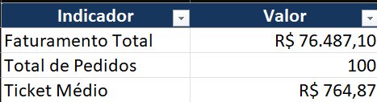

# Commercial Reporting Automation with Python

🌐 **English** | [Português (Brasil)](README.pt-BR.md)

**Automated pipeline for commercial data processing, inconsistency auditing, and Excel management reporting.**

This portfolio project demonstrates how Python can replace repetitive spreadsheet consolidation tasks, improving standardization, traceability, and reporting reliability.

## Overview

Businesses often need to combine sales CSV files, correct formatting problems, identify inconsistencies, and calculate commercial KPIs. This pipeline automates the workflow from file ingestion through Excel report generation and validation.

## Features

- Automatically consolidate multiple CSV files.
- Check required columns and duplicate records.
- Clean and standardize sales amounts.
- Flag missing data and suspicious numeric formats.
- Calculate revenue, order counts, and average order value.
- Analyze revenue by year and category and rank products by revenue.
- Export formatted Excel reports and validate their structure and financial totals.
- Record execution logs, handle errors, and run automated tests.
- Run a standalone demonstration using fictional data.

## Quick demo

The repository includes **100 fictional records** in four CSV files covering 2022–2025. No real commercial data is required.

### 1. Clone the repository

```bash
git clone https://github.com/Guilherme-milani-27/automacao-relatorios-comerciais.git
cd automacao-relatorios-comerciais
```

### 2. Create a virtual environment (Windows)

```powershell
py -m venv .venv
```

### 3. Install dependencies

```powershell
.\.venv\Scripts\python.exe -m pip install -r requirements.txt
```

### 4. Run the demo

```powershell
.\.venv\Scripts\python.exe executar_demo.py
```

The system processes the fictional CSV files, calculates KPIs, exports an Excel workbook, and verifies report integrity.

### Expected output

| Metric | Result |
|---|---:|
| CSV files consolidated | 4 |
| Records processed | 100 |
| Revenue | R$ 76,487.10 |
| Inconsistencies | 0 |
| Categories | 3 |
| Products | 6 |
| Excel worksheets | 6 |

**Generated file:** `relatorios_demo/Relatorio_Demonstrativo.xlsx`

All demo records are fictional, and the results are reproducible.

## Excel report

### Sample generated report

The image below shows commercial KPIs automatically calculated from the fictional dataset.



The workbook contains six worksheets:

| Worksheet | Contents |
|---|---|
| `Resumo_Geral` | Total revenue, orders, and average order value |
| `Resumo_Anual` | KPIs grouped by year |
| `Vendas_Tratadas` | Consolidated, cleaned sales records |
| `Inconsistencias` | Records requiring review |
| `Resumo_Categorias` | Revenue and orders by category |
| `Ranking_Produtos` | Products ranked by revenue |

Worksheets include formatted headers, filters, frozen top rows, adjusted column widths, and numeric formatting.

## How it works

**CSV files → Consolidation → Cleaning → Audit → KPIs → Excel export → Validation**

The pipeline checks data integrity during processing and logs execution details. Final validation compares the Excel report's structure and values with the results calculated in Python.

## Project structure

```text
automacao-relatorios-comerciais/
├── dados_demo/
│   ├── vendas_2022.csv
│   ├── vendas_2023.csv
│   ├── vendas_2024.csv
│   └── vendas_2025.csv
├── dados_entrada/
│   └── arquivos_mensais/
├── investigacoes/
├── logs/
├── relatorios/
├── relatorios_demo/
├── src/
│   ├── exportacao.py
│   ├── historico.py
│   ├── indicadores.py
│   ├── leitura.py
│   ├── limpeza.py
│   ├── logs.py
│   ├── relatorio_erros.py
│   ├── status.py
│   ├── validacao.py
│   └── validacao_relatorio.py
├── testes/
├── config.py
├── executar.bat
├── executar_demo.py
├── gerar_dados_demo.py
├── main.py
├── preparar_dados.py
├── requirements.txt
├── README.md
└── README.pt-BR.md
```

**Note:** `dados_entrada/`, `logs/`, `relatorios/`, and `relatorios_demo/` are used at runtime and do not need to contain version-controlled files.

## Using your own CSV files

1. Place CSV files in `dados_entrada/arquivos_mensais/`.
2. Name them using the `vendas_*.csv` pattern.
3. Ensure they contain the columns required by the pipeline.
4. Run:

```powershell
.\.venv\Scripts\python.exe main.py
```

The main report is generated at `relatorios/Relatorio_Consolidado.xlsx`.

**Compatibility note:** The current cleaning logic targets a specific commercial data layout. CSV files from other sources may require adaptations.

## Validation and tests

Checks cover input file and record counts, required columns, duplicate identifiers, missing data, suspicious number formats, Excel worksheet structure, exported record counts, financial reconciliation, and error scenarios. Test scripts are available in `testes/`.

## Development results

During development, the main pipeline was tested on a **9,800-record Superstore dataset**. These development results are separate from the fictional 100-record demo distributed with this repository.

| Metric | Result |
|---|---:|
| CSV files consolidated | 4 |
| Records processed | 9,800 |
| Validated revenue | R$ 2,261,536.78 |
| Inconsistencies identified | 11 |

## Technologies

- **Python:** automation orchestration.
- **Pandas:** ingestion, cleaning, consolidation, and analysis.
- **OpenPyXL:** Excel formatting and workbook manipulation.
- **Git and GitHub:** version control and code sharing.
- **Excel:** management reporting.

## Potential improvements

- Simplified graphical interface.
- Better performance on larger datasets.
- Configurable support for multiple CSV layouts.
- Broader automated test coverage.
- Additional management visualizations.

## Author

**Guilherme Milani**

Portfolio project showcasing Python automation, data cleaning, process reliability, and commercial reporting.

[Read the complete Portuguese version →](README.pt-BR.md)
