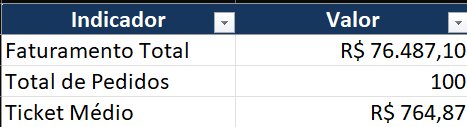

🌐 [English](README.md) | Português

# Automação de Relatórios Comerciais com Python

**Pipeline automatizado de processamento de dados comerciais, auditoria de inconsistências e geração de relatórios gerenciais em Excel.**

Projeto desenvolvido para demonstrar como Python pode substituir tarefas repetitivas de consolidação de planilhas, aumentando a padronização, a rastreabilidade e a confiabilidade dos relatórios.

## Visão geral

Empresas que trabalham com relatórios de vendas frequentemente precisam consolidar diversos arquivos CSV, corrigir problemas de formatação, identificar inconsistências e calcular indicadores comerciais.

Quando essas atividades são realizadas manualmente, o processo pode consumir tempo e aumentar o risco de erros.

Este projeto automatiza essas etapas por meio de um pipeline Python, desde a leitura dos arquivos até a geração e validação do relatório final.

## Funcionalidades

- Consolidação automática de múltiplos arquivos CSV.
- Verificação de colunas obrigatórias e registros duplicados.
- Tratamento e padronização de valores de vendas.
- Identificação de dados ausentes e formatos suspeitos.
- Cálculo de faturamento, quantidade de pedidos e ticket médio.
- Análise de faturamento por ano e categoria.
- Ranking de produtos por faturamento.
- Exportação de relatórios Excel formatados.
- Validação automática da estrutura e dos valores financeiros.
- Registro de logs, histórico de execuções e tratamento de erros.
- Testes automatizados e ambiente demonstrativo independente.

## Demonstração rápida

O repositório inclui uma base com **100 registros fictícios**, distribuídos em quatro arquivos CSV referentes aos anos de 2022 a 2025.

É possível executar a demonstração sem utilizar dados comerciais reais.

### 1. Clonar o repositório

```bash
git clone https://github.com/Guilherme-milani-27/automacao-relatorios-comerciais.git
cd automacao-relatorios-comerciais
```

### 2. Criar um ambiente virtual

No Windows:

```powershell
py -m venv .venv
```

### 3. Instalar as dependências

```powershell
.\.venv\Scripts\python.exe -m pip install -r requirements.txt
```

### 4. Executar a demonstração

```powershell
.\.venv\Scripts\python.exe executar_demo.py
```

O sistema processará os CSVs fictícios, calculará os indicadores, exportará o Excel e verificará a integridade do relatório.

### Resultado esperado

| Indicador | Resultado |
|---|---|
| Arquivos consolidados | 4 |
| Registros processados | 100 |
| Faturamento | R$ 76.487,10 |
| Inconsistências | 0 |
| Categorias | 3 |
| Produtos | 6 |
| Abas do Excel | 6 |

**Arquivo gerado:** `relatorios_demo/Relatorio_Demonstrativo.xlsx`

Os dados são inteiramente fictícios. Os valores apresentados são resultados reproduzíveis da demonstração.

## Relatório Excel

### Exemplo do relatório gerado

A imagem abaixo apresenta os indicadores comerciais
calculados automaticamente a partir dos dados fictícios.



O relatório contém seis abas:

| Aba | Conteúdo |
|---|---|
| `Resumo_Geral` | Faturamento total, pedidos e ticket médio |
| `Resumo_Anual` | Indicadores agrupados por ano |
| `Vendas_Tratadas` | Base consolidada com valores tratados |
| `Inconsistencias` | Registros que exigem revisão |
| `Resumo_Categorias` | Faturamento e pedidos por categoria |
| `Ranking_Produtos` | Produtos classificados por faturamento |

As planilhas recebem cabeçalhos formatados, filtros, congelamento da primeira linha, ajuste de colunas e formatação numérica.

## Como funciona

O pipeline segue as etapas:

**Arquivos CSV → Consolidação → Tratamento → Auditoria → Indicadores → Exportação Excel → Validação**

Durante o processamento, o sistema verifica a integridade dos dados e registra informações sobre a execução.

A validação final compara a estrutura e os valores do relatório com os resultados calculados pelo Python.

## Estrutura do projeto

```text
automacao-relatorios-comerciais/
├── dados_demo/
│   ├── vendas_2022.csv
│   ├── vendas_2023.csv
│   ├── vendas_2024.csv
│   └── vendas_2025.csv
├── dados_entrada/
│   └── arquivos_mensais/
├── investigacoes/
├── logs/
├── relatorios/
├── relatorios_demo/
├── src/
│   ├── exportacao.py
│   ├── historico.py
│   ├── indicadores.py
│   ├── leitura.py
│   ├── limpeza.py
│   ├── logs.py
│   ├── relatorio_erros.py
│   ├── status.py
│   ├── validacao.py
│   └── validacao_relatorio.py
├── testes/
├── config.py
├── executar.bat
├── executar_demo.py
├── gerar_dados_demo.py
├── main.py
├── preparar_dados.py
├── requirements.txt
└── README.md
```

**Observação:** as pastas `dados_entrada/`, `logs/`, `relatorios/` e `relatorios_demo/` são utilizadas durante a execução e não precisam conter arquivos versionados no Git.

## Executando com arquivos próprios

Para utilizar o pipeline principal:

1. Coloque os arquivos CSV na pasta `dados_entrada/arquivos_mensais/`.
2. Utilize nomes no padrão `vendas_*.csv`.
3. Verifique se os arquivos possuem as colunas exigidas pelo sistema.
4. Execute:

```powershell
.\.venv\Scripts\python.exe main.py
```

O relatório principal será gerado em:

`relatorios/Relatorio_Consolidado.xlsx`

O tratamento atual foi desenvolvido para um layout específico de dados comerciais. Arquivos de outras origens podem exigir adaptações.

## Validação e testes

O projeto possui verificações de:

- Quantidade de arquivos e registros processados.
- Presença de colunas obrigatórias.
- Identificadores duplicados.
- Dados ausentes e formatos numéricos suspeitos.
- Estrutura das abas do Excel.
- Quantidade de registros exportados.
- Correspondência dos valores financeiros.
- Comportamento em situações de erro.

Também estão disponíveis scripts de teste na pasta `testes/`.

## Resultados do desenvolvimento

Durante o desenvolvimento, o pipeline principal foi testado com uma base Superstore de 9.800 registros.

| Indicador | Resultado |
|---|---|
| Arquivos consolidados | 4 |
| Registros processados | 9.800 |
| Faturamento validado | R$ 2.261.536,78 |
| Inconsistências identificadas | 11 |

Esses resultados correspondem aos testes realizados durante o desenvolvimento e são distintos da base fictícia de 100 registros disponibilizada neste repositório.

## Tecnologias utilizadas

- **Python:** desenvolvimento e orquestração da automação.
- **Pandas:** leitura, limpeza, consolidação e análise dos dados.
- **OpenPyXL:** formatação e manipulação dos relatórios Excel.
- **Git e GitHub:** versionamento e distribuição do código.
- **Excel:** apresentação dos indicadores gerenciais.

## Próximas melhorias

- Interface gráfica simplificada para execução.
- Otimização do desempenho em grandes volumes de dados.
- Suporte configurável a diferentes layouts de CSV.
- Ampliação dos testes automatizados.
- Novas visualizações gerenciais.

## Autor

**Guilherme Milani**

Projeto de portfólio desenvolvido para demonstrar competências em automação de processos, Python, tratamento de dados e geração de relatórios comerciais.
